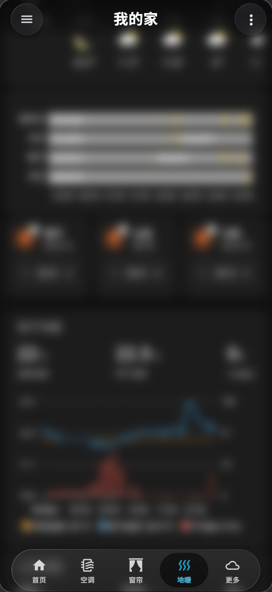

# Glass UI for Home Assistant

把 Home Assistant 仪表盘换成 iOS 26 风格的「液态玻璃」外观：左上玻璃 ☰、居中标题、右上 ⋮、底部玻璃胶囊 dock。

**它只是外观层。** ☰ 走原生 `hass-toggle-menu`，⋮ 就是原生 `ha-dropdown`，dock 就是原生 `ha-tab-group` —— 切页、菜单、侧边栏全部是 HA 自己的逻辑，不会出现"点了没反应"或"按钮是假的"。



- 适用：Home Assistant 2024.1+（2026.x 已实测）
- 不依赖 card-mod / kiosk-mode / 任何自定义卡片
- 编辑仪表盘模式自动还原成原生外观（标题照常可编辑）

---

## 安装

### 方式一：HACS（推荐）

1. HACS → 右上 ⋮ → **自定义存储库**
   - 存储库：`https://github.com/dw881114/glass-ui`
   - 类别：**Lovelace / 仪表盘（前端）**
2. HACS → **前端** → 搜索 **Glass UI** → 下载
3. 刷新页面（HACS 会自动加资源；没有的话在 设置 → 仪表盘 → 资源 里手动加
   `/hacsfiles/glass-ui/glass-ui.js`，类型 **JavaScript 模块**）

> 还没发布到 HACS 默认商店时，必须用「自定义存储库」添加，装好后一样能收到更新。

### 方式二：手动

1. 把 `glass-ui.js` 放到 `/config/www/glass-ui/glass-ui.js`
2. 设置 → 仪表盘 → 右上 ⋮ → 资源 → 添加
   - URL：`/local/glass-ui/glass-ui.js`
   - 类型：**JavaScript 模块**
3. 刷新页面

卸载：删掉资源 + 删掉文件即可，不会动任何仪表盘配置。

---

## 配置

默认只作用于 `url_path = lovelace`（默认「概览」仪表盘）。两种覆盖方式都不用改文件，升级也不会丢：

**1) 资源 URL 查询参数**（手写资源最方便）

```
/hacsfiles/glass-ui/glass-ui.js?dashboards=lovelace,home&tabLabel=0
```

| 参数 | 说明 |
|---|---|
| `dashboards` | 生效的仪表盘 url_path，逗号分隔；`*` = 全部 |
| `tabLabel` | `0` 关掉 dock 图标下面的文字 |
| `iconSize` / `tabLabelSize` | 图标 / 文字大小（px） |
| `hideExtraActions` | `0` 保留搜索 / 语音助手 / 编辑三个按钮 |
| `addEditMenuItem` | `0` 不在 ⋮ 菜单里补「编辑仪表盘」 |
| `collapseSidebarOnWide` | `0` 宽屏不收起侧边栏 |

**2) 在它之前加载的脚本里设置全局对象**（深合并，可改任意嵌套项）

```js
window.GLASS_UI_CONFIG = {
  dashboards: ["lovelace", "home"],
  dock: { height: 64, pressGrowExtraWidth: 12 },
  tabLabelSize: 11,
};
```

常用默认值：

```js
{
  dashboards: ["lovelace"],
  title: "auto",            // "auto" 标题挪到顶栏；"none" 不显示
  titleBarHeight: 56,
  iconSize: 22,
  tabLabel: true,
  tabLabelSize: 10,
  dock: {
    maxWidth: 396,
    height: 60,
    inset: 5,
    bottom: 1,              // 安卓 / 桌面
    bottomIOS: 22,          // iOS（Home 指示条安全区）
    pressGrowExtraWidth: 10, // 按住时左右各加宽
    pressGrowExtraHeight: 5, // 按住时高度 = 胶囊高度 + 5
    pressGrowDelay: 140,
    moveDuration: 486,
    growDuration: 200,
  },
  topButtons: { size: 46, iconSize: 21 },
  collapseSidebarOnWide: true,
}
```

---

## 交互

| 操作 | 行为 |
|---|---|
| 点 ☰ | 窄屏开侧边栏抽屉；宽屏停靠 / 收起侧边栏 |
| 点 ⋮ | 原生下拉菜单，弹出位置直接盖住圆钮；点菜单外只关菜单，不会点到底层卡片 |
| 点 dock 图标 | 切页（原生 tab 行为） |
| 按住 / 拖动 dock | 高亮块跟手横移；按下即生效（不用长按）；停在某一格 200ms 自动切页；松手吸到最近一格 |
| 按住图标 | 高亮块变宽 +5px 高、左右各 +10px，颜色变实；松手缩回 |
| 蓝色图标 | **只出现在高亮块压住的那一段**，其余保持未选中色 |

细节：

- 底栏上上下滑不会滚动页面（`touch-action: none` + 非 passive 的 `touchmove`）
- 高亮块层级：胶囊底色 → 高光边 → 黑块 → 图标
- 子视图（`subview: true`）不进底栏；没有原生 tab 栏时（子视图 / 只有一个视图）自动换成一个同样的自建底栏
- 深 / 浅色主题自动跟随 HA（`hass.themes.darkMode`）
- 安卓：文档滚动会搬进内容层，避免 WebView 拉伸带跑底栏和按钮；iOS 保持系统下拉刷新

---

## 已知限制

- 只改外观，**不提供**任何卡片、实体或自动化。
- 依赖 HA 前端内部结构（`hui-root` / `ha-tab-group` 的 shadow DOM）。HA 大版本改版时可能需要跟进，见 CHANGELOG。
- 宽屏下默认把侧边栏收起（`collapseSidebarOnWide`），不喜欢可以关掉。

## 许可

MIT
